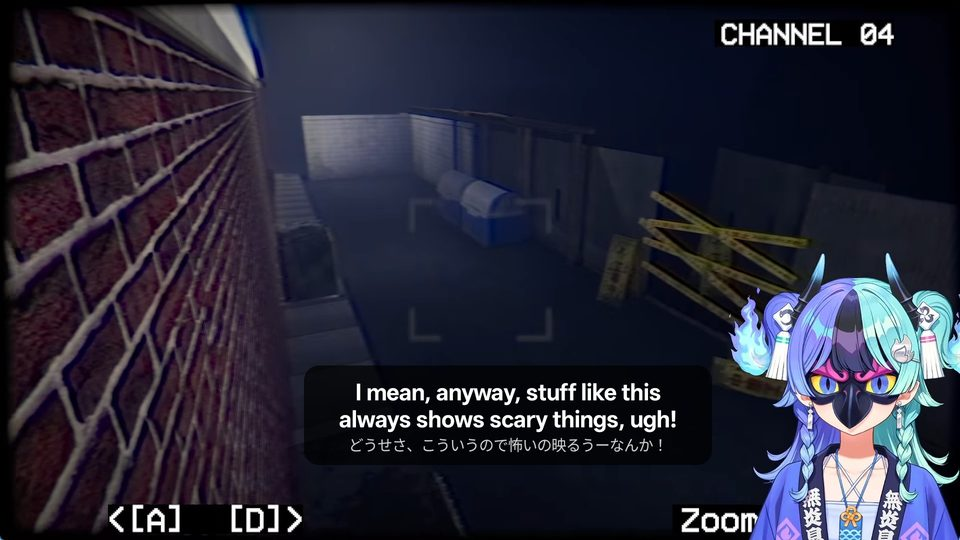
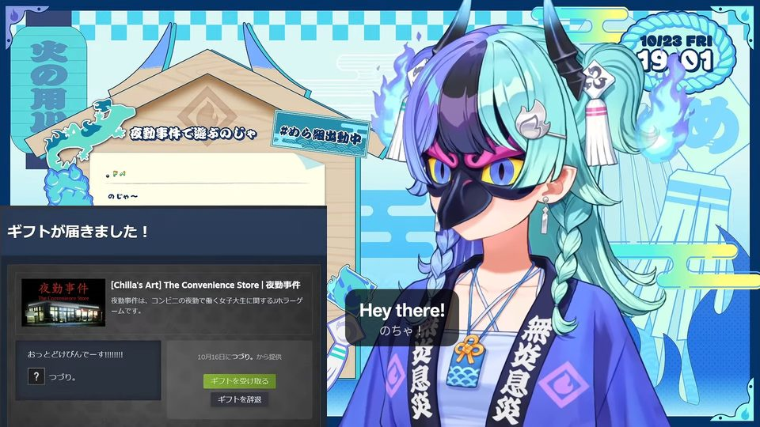
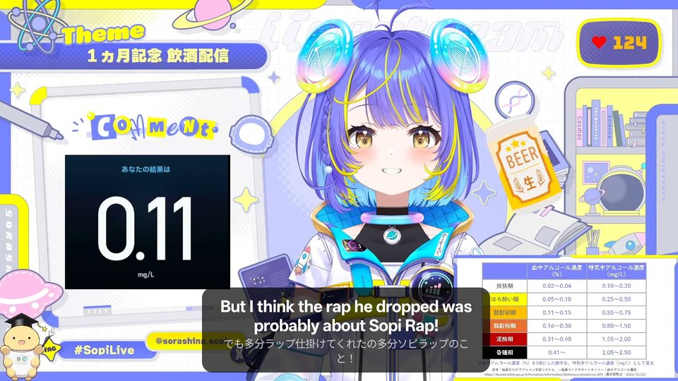
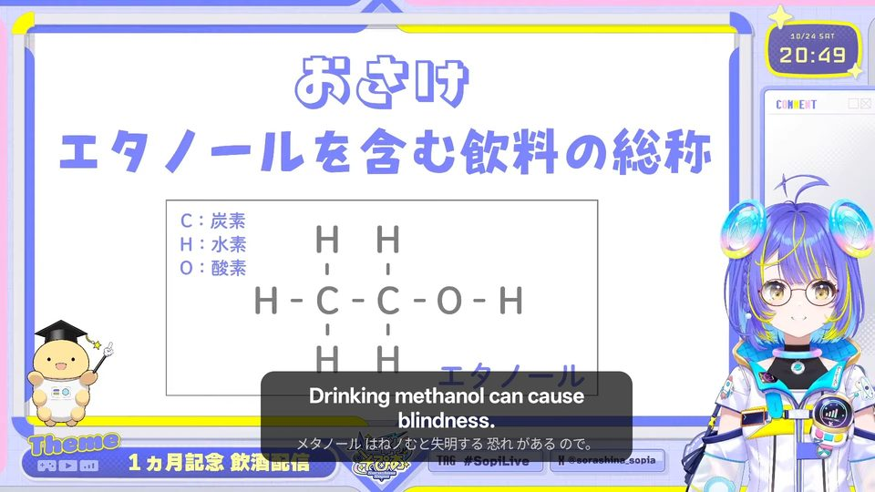
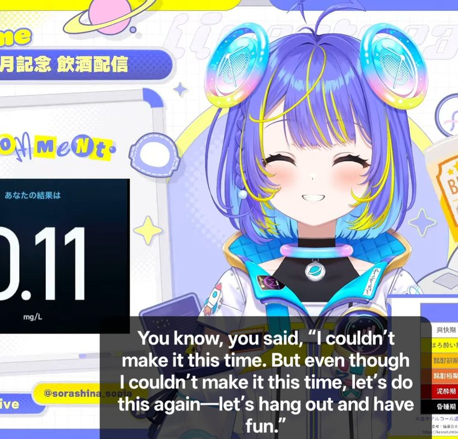
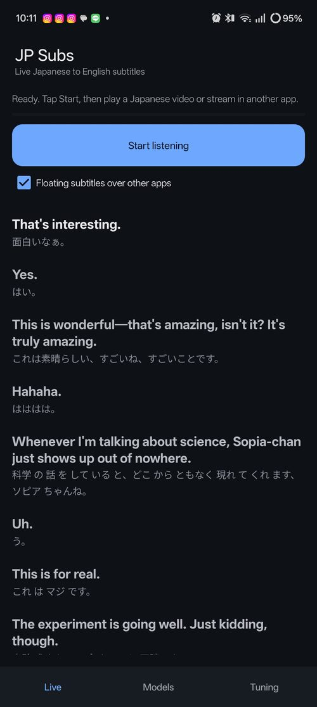
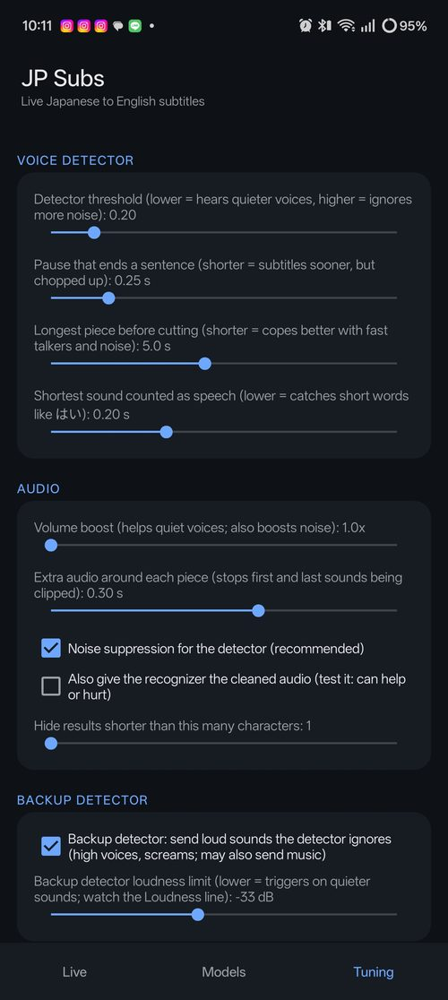
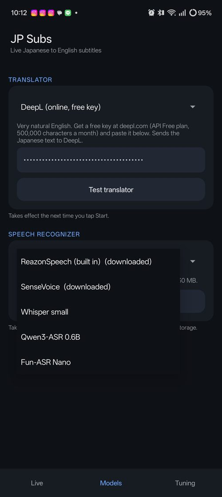

# JP Subs


**Live English subtitles for Japanese streams and videos, on your Android phone.**
JP Subs listens to the sound your phone is playing (YouTube, Twitter/X, a game, anything),
recognizes the Japanese speech, translates it and shows the English as floating subtitles over
the other app. Japanese to English only. Free and open source.

> Version 1.0.1. Tested on a Realme 12 Pro+ (Snapdragon 7s Gen 2) and an Oppo A96 (Snapdragon 680)
> with SenseVoice and Google Translate. The two biggest recognizers may be too slow on weak phones.

## Screenshots

Subtitles floating over a stream (English on top, the Japanese heard underneath):

<p>
  
  
</p>
<p>
  
  
</p>
<p>
  
</p>

The app's three tabs: **Live**, **Tuning** and **Models**.

<p>
  
  
  
</p>

> The stream images belong to their creators and are shown only to demonstrate the app.

## Features

- Works with any app that plays sound (it captures playback audio, not the microphone).
- Speech recognition runs **on the phone**: no account, nothing leaves the device for that step.
- Pick your own speech recognizer and translator, and delete the ones you do not use.
- Floating subtitle box you can drag; it shrinks to fit the text and follows screen rotation.
- Noise suppression, a backup detector for high voices and screams, and live tuning sliders.
- Dark interface with three tabs: **Live**, **Models**, **Tuning**.
- Tells you when a new version is out and can download and install it for you.

## Install

1. On your phone open the **Releases** page of this repo and download `JP-Subs.apk` from the
   newest version (the **Latest build** page has the newest test build).
2. Open the downloaded file (allow "install unknown apps" for your browser if asked).
   Android 10 or newer is required.
3. Open JP Subs. The first-run guide offers **Set up for me**, which downloads about 420 MB
   (Wi-Fi recommended) and picks good defaults (SenseVoice recognizer, Google Translate).
4. Open a Japanese video or stream in another app, come back, tap **Start**, allow the
   permissions Android asks for, and tick **Floating subtitles over other apps** (Android opens a
   page where you switch JP Subs on).

Updates install over the old version and keep your settings and downloaded models.

**In-app updates:** when you open the app it quietly checks this repo for a newer official release.
If there is one, it asks: **Update** (downloads the APK and opens Android's installer; the first
time Android asks you to allow JP Subs to install apps) or **Remind me later** with a choice of
1 to 7 days or never. You can check by hand, or switch automatic checks on or off, in
**Tuning > Other**. Only official versions (tags like `v1.0.1`) are offered, not test builds.

## Choosing models

**Speech recognizers** (Models tab; the first is built in, the others are optional downloads):

| Recognizer | Size | Notes |
|---|---|---|
| ReazonSpeech | ~165 MB | Fast, made for Japanese. |
| **SenseVoice** | ~230 MB | Fast and accurate, adds punctuation. Recommended. |
| Fun-ASR Nano | ~950 MB | As accurate as SenseVoice, better with katakana, needs a strong phone. |
| Qwen3-ASR 0.6B | ~940 MB | Most accurate but 3 to 4 seconds late; may print odd text. |
| Whisper small | ~370 MB | Too slow on most phones. Not recommended. |

**Translators:**

| Translator | Needs | Notes |
|---|---|---|
| Google ML Kit | nothing, offline | Basic; weak with slang. |
| **Google Translate** | internet | Fast and accurate, no account. Unofficial web address, may be limited. Recommended to start. |
| **DeepL** | free key from deepl.com | Most natural English. |
| AI chat model | key for any OpenAI-compatible service (default: Google Gemini) | Best with slang; sees the last 3 lines. |

**Privacy:** the online translators receive the Japanese *text* (never the audio). Your API keys
are stored only on your phone. Never put a key in this repository.

## Tuning tips

Open the **Tuning** tab while a stream plays (use a small window next to the video).

- Sentences chopped in the middle: raise **Longest piece** (5 to 6 s).
- Quiet voices missed: lower **Detector threshold** (0.25 to 0.30).
- Noise treated as speech: raise the threshold, keep noise suppression on.
- High-pitched voices or screams ignored: turn on the **Backup detector** and set its limit just
  below the dB value shown in the debug lines (it may also send loud music).
- Debug lines on the Live tab show what the detector hears and how long each step takes.

## Troubleshooting

- **"Package appears to be invalid"**: the download was cut off. Download `JP-Subs.apk` again.
- **Nothing appears:** check the Live tab status line and the debug lines; make sure the app
  playing the sound allows capture (some apps and DRM video block it).
- **Online translator errors:** the debug lines show the reason; ML Kit answers meanwhile.
- **Subtitles late or "skipped some speech":** use a smaller recognizer.

## Build it yourself (no computer needed)

The APK is built by GitHub Actions (`.github/workflows/build.yml`) every time you push to `main`.
Update from Termux (change the version in the zip name and in the commit message each time):

```bash
cd ~/downloads
unzip -o jpsubs-v1.0.1.zip -d jpsubs-milestone1
cd jpsubs-milestone1/jpsubs
git add .
git commit -m "Update to 1.0.1"
git push
```

Keep the folder name `jpsubs-milestone1`: it holds the hidden `.git` folder from your first push.
The repo must stay **public**, because the app downloads its models from this repo's Releases.
The first build also copies the optional recognizer models onto the Releases page (a few minutes).

Signing a release with your own private key and publishing a version: see
[docs/RELEASING.md](docs/RELEASING.md).

## How it works

```
phone audio -> noise suppression -> voice detector -> recognizer -> translator -> subtitles
               (GTCRN)              (Silero VAD)      (sherpa-onnx)  (ML Kit / online)
```

Source layout: `CaptureService.kt` (audio pipeline), `FrontEnd.kt` (noise suppression and
detector), `AsrModels.kt` and `ModelManager.kt` (model downloads), `Translators.kt`,
`SubtitleOverlay.kt` (floating box), `MainActivity.kt` (screens), `Settings.kt` and `Tuning.kt`.

## Credits and licences

Built on [sherpa-onnx](https://github.com/k2-fsa/sherpa-onnx) (Apache-2.0) and the models listed
in [NOTICE.md](NOTICE.md). JP Subs itself is released under the [MIT License](LICENSE).
See [CHANGELOG.md](CHANGELOG.md) for version history.
